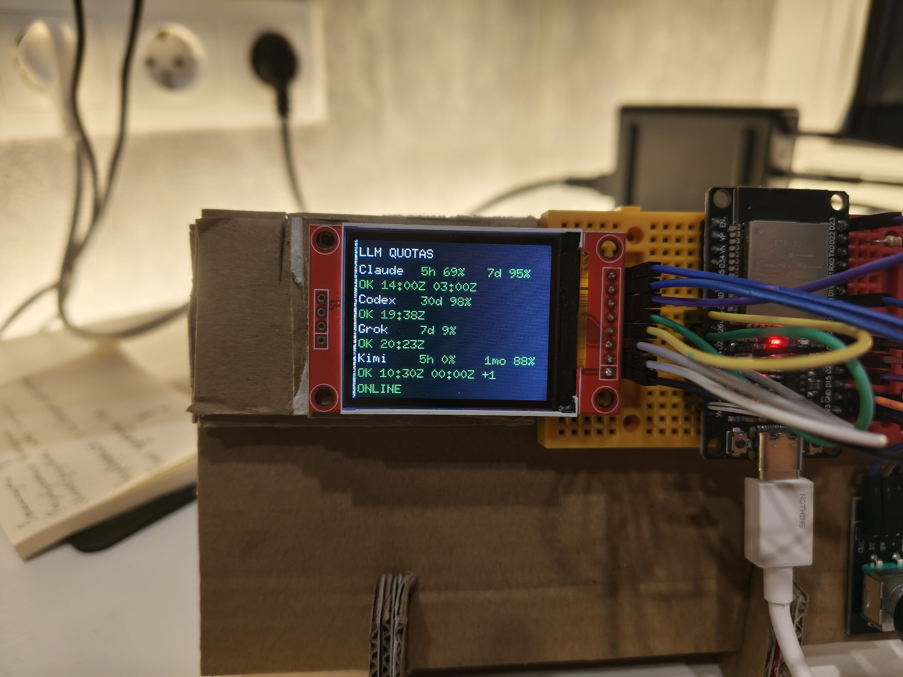
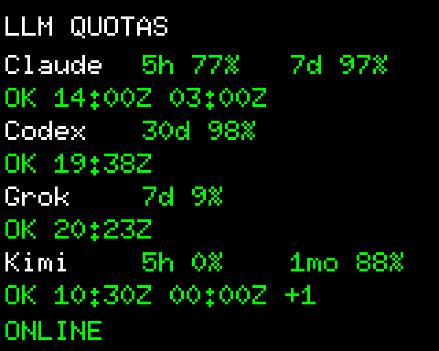
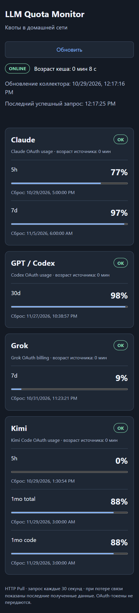
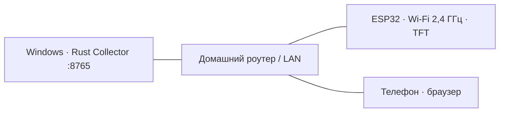
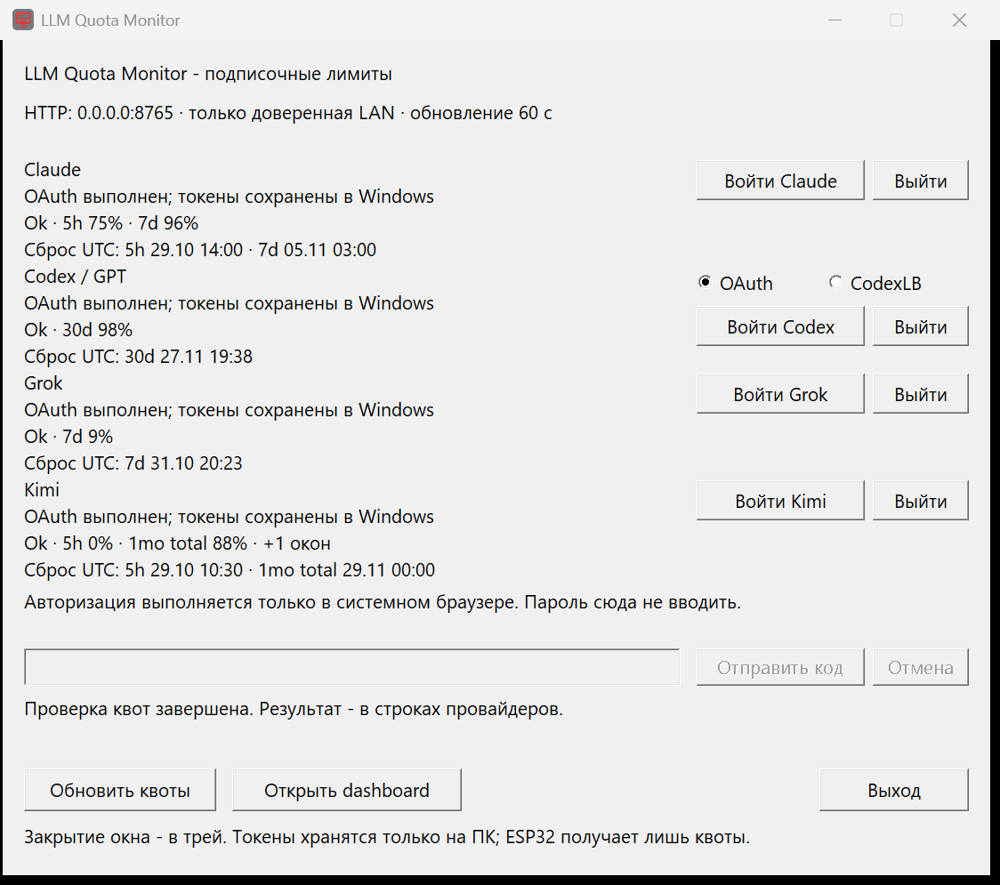
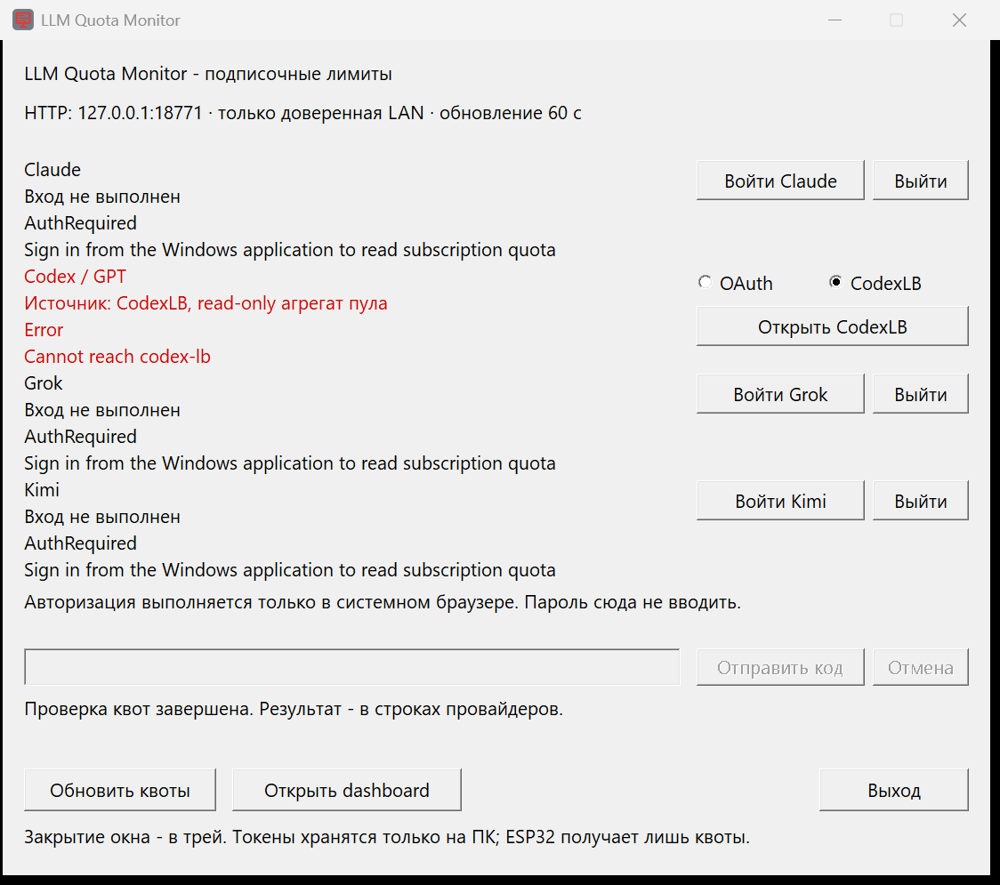
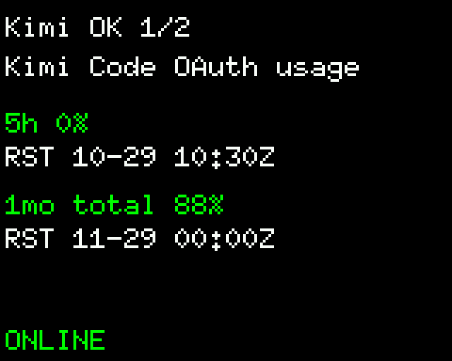

# LLM Quota Monitor

Домашний монитор лимитов подписок на LLM: **Claude, Codex (ChatGPT), Grok, Kimi**. Windows-приложение само ходит за квотами и отдаёт их по HTTP в локальной сети, а маленький экран на ESP32 показывает остатки и время сброса лимитов. Тот же endpoint открывается в браузере телефона.
<p>
    
</p>

<p>
  
  
</p>

Скриншот TFT - это не фото, а кадр, который рисует **та же функция отрисовки из прошивки**, запущенная на ПК с настоящим ответом коллектора.



## Возможности

| Компонент | Что делает |
| --- | --- |
| Windows-приложение | Нативные Win32-контролы и трей, без Electron и WebView. Кнопки входа, ручной ввод кода, обновление, открытие dashboard. HTTP-сервис работает в том же процессе |
| Квоты | Claude, Codex, Grok и Kimi через собственный OAuth. У Codex можно выбрать OAuth или read-only пул [codex-lb](https://soju06.github.io/codex-lb/) |
| Время сброса | Реальные `resets_at` из ответов провайдеров в окне, dashboard и на TFT. Если источник время не сообщил, показывается "неизвестно", а не придуманная дата |
| Ошибки | Строка провайдера с ошибкой запроса квот подсвечивается красным (см. ниже) |
| Dashboard | `/`, адаптивная страница без внешних CDN, обновление раз в 30 секунд |
| ESP32 | Wi-Fi Station, опрос `/api/quotas` раз в 30 секунд, экран ST7735S 160×128 после поворота, индикатор связи на GPIO22 |
| Энкодер KY-040 | Вращение и нажатие открывают детали провайдера и страницы окон |
| Иконка | Серый фон, красный монитор. Встроена в EXE, окно, taskbar и трей |

Токены хранятся **только на Windows** (пользовательский DPAPI). На ESP32 попадает лишь нормализованный JSON с процентами.



Если запрос квот завершился ошибкой (сеть, HTTP 429/5xx, неожиданный ответ, недоступный codex-lb), строка провайдера становится красной:



Подсвечивается только статус `error`. `AUTH REQUIRED`, `UNAVAILABLE` и `STALE` красными не бывают: это отсутствие входа или доступа и устаревшие данные, а не сбой запроса.

## Требования

**Windows-приложение**

- Windows 11 (на других версиях не проверялось)
- Rust stable с целью MSVC и Microsoft C++ Build Tools

**Прошивка ESP32** (по желанию)

- Плата на чипе ESP32 (`xtensa-esp32-espidf`) и USB-кабель с данными. Проверялась плата с USB-UART мостом CH340
- Rust-тулчейн для Xtensa: `cargo install espup espflash ldproxy --locked`, затем `espup install` (создаёт `~/export-esp.ps1`)
- CMake (`winget install Kitware.CMake`), Python 3, Git
- Wi-Fi **2,4 ГГц**

## Быстрый старт: Windows

Из корня репозитория:

```powershell
cargo build --release --locked -p quota-collector --bin quota-monitor --target-dir target
Start-Process .\target\release\quota-monitor.exe
```

Запускайте готовый EXE, а не `cargo run`: так Cargo не остаётся лишним процессом. Крестик окна прячет приложение в трей, полностью закрывает кнопка **Выход** (или пункт меню значка). Двойной щелчок по значку возвращает окно.

Приложение слушает `0.0.0.0:8765`. На своём ПК: `http://127.0.0.1:8765/` (dashboard) и `http://127.0.0.1:8765/api/quotas` (JSON). Если порт занят прежним экземпляром, приложение не запустится и скажет об этом.

Необязательные переменные окружения процесса:

```powershell
$env:QUOTA_BIND = '0.0.0.0:8765'          # IP:порт
$env:QUOTA_REFRESH_SECONDS = '60'         # период опроса провайдеров
$env:CODEX_LB_URL = 'http://127.0.0.1:2455'
$env:CODEX_SOURCE = 'oauth'               # или 'codex_lb': начальный источник Codex
```

Выбор источника Codex в окне сохраняется в `%LOCALAPPDATA%\LLMQuotaMonitor\settings.json`. До первого выбора используется codex-lb.

### Без окна

После первого входа в GUI можно запустить тот же движок без интерфейса:

```powershell
cargo run --release --locked -p quota-collector --bin quota-collector
```

Авторизация и выбранный источник берутся из того же хранилища, выход - `Ctrl+C`. OAuth-управление доступно только локальному окну, не LAN API.

## Вход в провайдеры

Все входы выполняются в системном браузере. Пароли в приложение вводить не нужно.

1. **Claude**: **Войти Claude**, завершить вход в браузере. Возврат принимается только на `http://localhost:54545/callback`. Если он не сработал, вставьте выданный код или полный callback URL в маскированное поле и нажмите **Отправить код**.
2. **Codex**: выберите **OAuth**, **Войти Codex**, подтвердите вход ChatGPT. Callback фиксирован: `http://localhost:1455/auth/callback`; если порт занят, вход завершится понятной ошибкой. **CodexLB** переключает на агрегат существующего пула без повторной авторизации.
3. **Grok**: **Войти Grok**, подтвердите device authorization с показанным кодом. Нужен доступ аккаунта к Grok CLI/OAuth.
4. **Kimi**: **Войти Kimi**, подтвердите device authorization. Используется Kimi Code OAuth, а не API-ключ Kimi Platform.

**Отмена** прекращает текущий вход и не стирает прежнюю авторизацию. **Выйти** удаляет локальную авторизацию выбранного провайдера и его цифры; согласие на стороне сервиса это не отзывает, его снимают в настройках провайдера.

У Codex переключение источника очищает цифры прежнего источника: OAuth показывает один аккаунт, codex-lb - агрегат пула. Ошибка OAuth не включает скрытый fallback на codex-lb.

## Хранение токенов и безопасность

- `%LOCALAPPDATA%\LLMQuotaMonitor\auth\{claude,codex,grok,kimi}.dpapi` содержат только зашифрованные пользовательским DPAPI данные.
- Новые refresh-токены пишутся атомарно с flush до следующего обновления. Ошибка записи приостанавливает refresh; `invalid_grant` требует нового входа.
- Каталог данных блокируется на время работы, чтобы два экземпляра не ротировали одни и те же токены. `QUOTA_DATA_DIR` задаёт другой каталог для изолированного профиля. Не запускайте копии одной сессии из разных каталогов.
- DPAPI не переносится на другой Windows-аккаунт и не защищает от процессов того же пользователя или администратора.
- HTTP проверяет сертификаты, redirects запрещены. Таймаут запроса квот 15 секунд, размер ответа не более 1 МиБ, OAuth JSON не более 64 КиБ.
- **LAN API не аутентифицирован и не шифруется.** Он отдаёт только проценты и время сброса, без токенов и без почты. Используйте его только в доверенной сети, не пробрасывайте порт в интернет.

## Доступ из локальной сети

Телефон и ESP32 должны быть в той же сети без изоляции клиентов. Узнайте адрес ПК (`ipconfig`) и закрепите его DHCP-резервацией в роутере. Дальше открывайте `http://<адрес ПК>:8765/`.

Если Windows блокирует входящие соединения, правило брандмауэра создаётся скриптом, который разрешает TCP 8765 только на указанном интерфейсе, в профиле **Private** и от `LocalSubnet`. Он отказывается работать в профиле Public и не перезаписывает существующее правило. В PowerShell **от администратора**, и только если сеть действительно доверенная:

```powershell
.\scripts\allow-collector.ps1 -InterfaceAlias 'Ethernet'
```

Удаление: `Remove-NetFirewallRule -Name LlmQuotaMonitor8765`. Профиль сети скрипт сам не меняет, а при активном VPN его может понадобиться разрешить для локального трафика.

## Подключение железа

Экран: модуль 1.8" TFT SPI 128×160. Контроллер `ST7735S` - предположение по маркировке `1.8 TFT SPI 128×160 V1.1`; успешная инициализация в логе не доказывает, что изображение видно.

| Контакт TFT | ESP32 |
| --- | --- |
| VCC | 3V3 |
| GND | GND |
| CS | GPIO27 |
| RESET | GPIO25 |
| A0 / DC | GPIO26 |
| SDA / MOSI | GPIO23 |
| SCK | GPIO18 |
| LED (подсветка) | 3V3 через резистор около 220 Ом |

Не подключайте подсветку напрямую, если не уверены в схеме модуля.

| Контакт KY-040 | ESP32 |
| --- | --- |
| VCC | 3V3 |
| GND | GND |
| CLK | GPIO2 |
| DT | GPIO4 |
| SW | GPIO16 |

Для энкодера включены внутренние pull-up, контакты активны при замыкании на GND. **Не подавайте 5 В на сигнальные входы.**

Индикатор связи: **GPIO22 → резистор 220-330 Ом → анод светодиода, катод → GND**. Не подключайте светодиод к GPIO без резистора.

| Состояние | GPIO22 / светодиод |
| --- | --- |
| Запуск, нет конфигурации | HIGH / горит |
| Wi-Fi отключён или нет IP | HIGH / горит |
| Wi-Fi есть, ответ коллектора недоступен или некорректен | HIGH / горит |
| Снимок получен успешно | LOW / не горит |
| Коллектор доступен, но данные устарели | LOW / не горит, на TFT отдельно `STALE` |

Светодиод отражает состояние **связи с коллектором**, а не доступность конкретного LLM: причина проблемы провайдера видна на экране. Здоровое соединение проверяется раз в 30 секунд, после ошибки HTTP повтор через 5 секунд, подключение к Wi-Fi повторяется через 10 секунд.

## Экран и энкодер

**Обзор** строится только из провайдеров, которые реально пришли в ответе: отсутствующие не рисуются заглушками. Одновременно помещаются до четырёх, у каждого видны остатки первых двух окон, статус и время их сброса (`HH:MMZ`, UTC; `--:--` - источник время не сообщил). `+N` в заголовке - дополнительные провайдеры, `+N` в строке - дополнительные окна.

**Управление**

| Действие | Результат |
| --- | --- |
| Нажатие | Обзор → детали первого провайдера; из деталей → обзор |
| Вращение в обзоре | Открывает первого или последнего провайдера |
| Вращение в деталях | Страницы окон (по два); при одной странице - следующий провайдер |

В деталях видны имя, источник, статус, остатки и полное время сброса `RST ММ-ДД ЧЧ:ММZ` либо `RST unknown`. Если выбранный провайдер пропал из нового ответа, экран возвращается в обзор. Автопереключения нет.



## Сборка и прошивка ESP32

На плату **не переносятся OAuth-токены**. Нужны только параметры Wi-Fi и адрес коллектора. Они встраиваются в прошивку при сборке:

```powershell
$env:WIFI_SSID = Read-Host 'SSID сети 2,4 ГГц'
$wifiPassword = Read-Host 'Пароль Wi-Fi' -AsSecureString
$env:WIFI_PASSWORD = [System.Net.NetworkCredential]::new('', $wifiPassword).Password
$env:COLLECTOR_URL = 'http://<адрес ПК>:8765/api/quotas'
.\scripts\build-firmware.ps1
Remove-Item Env:WIFI_PASSWORD
$wifiPassword.Dispose()
```

Поддерживаются WPA2-Personal (пароль 8-63 байта) и открытая сеть; SSID 1-32 байта. `COLLECTOR_URL` требует явный IP:порт и путь `/api/quotas`, без логина и query. DNS не нужен.

Пароль Wi-Fi остаётся в ELF и во flash и может попасть в build-кеш, поэтому **не публикуйте эти артефакты**. Если параметры не заданы или неверны, прошивка соберётся, но устройство покажет `CONFIG REQUIRED` и удержит GPIO22 включённым. Значений по умолчанию нет. Локальный `firmware.local.ps1` исключён из Git и автоматически не исполняется.

Скрипт `build-firmware.ps1` подгружает `~/export-esp.ps1`, находит CMake и вызывает `cargo +esp build -p quota-firmware --target xtensa-esp32-espidf -Z build-std=std,panic_abort --locked`. По умолчанию он собирает в **короткий путь `C:\t`**: ESP-IDF на Windows падает на длинных путях выходного каталога (`Too long output directory`). Параметры: `-TargetDir`, `-Release`. ESP-IDF закреплён на v5.5.3, ревизия `esp-idf-sys/hal/svc` - в корневом `Cargo.toml` и `Cargo.lock`.

Прошивка (замените порт на свой, закройте монитор порта):

```powershell
espflash flash --monitor --port COMx --bootloader C:\t\xtensa-esp32-espidf\debug\bootloader.bin C:\t\xtensa-esp32-espidf\debug\llm-quota-monitor
```

- `Failed to connect`: удерживайте **BOOT** в момент подключения и отпустите после `Using flash stub`.
- `DOWNLOAD_BOOT / waiting for download` после записи: отпустите BOOT и нажмите EN/RESET.
- `Access is denied`: порт занят другим монитором (`espflash monitor`, Serial Monitor VS Code/Arduino). Закройте его, два монитора одновременно не работают. Это не проблема режима BOOT.
- Выход из монитора - `Ctrl+C`.

`--bootloader` передаёт загрузчик из той же сборки ESP-IDF v5.5.3, а не встроенный в espflash.

## Как читаются квоты

| Провайдер | Источник | Что разбирается |
| --- | --- | --- |
| Claude | `https://api.anthropic.com/api/oauth/usage` | `five_hour`, `seven_day`, модельные окна и `limits[]`; `utilization` - это использованная доля |
| Codex (OAuth) | `https://chatgpt.com/backend-api/wham/usage` | Окна `rate_limit` и `additional_rate_limits` с реальной длительностью, UTC-сброс, `seat cap` если есть |
| Grok | `https://cli-chat-proxy.grok.com/v1/billing?format=credits` | Явный недельный `creditUsagePercent`; при unified billing также месячная included quota |
| Kimi | `https://api.kimi.com/coding/v1/usages` | `usage`, `limits[]`, `usages`: окна 5h, 7d и месячные, `detail.resetTime` / `reset_time` |
| Codex (пул) | локальный codex-lb | `/api/usage/summary` и `lastSyncAt` из `/api/dashboard/overview` |

Правила нормализации:

- Покупные overage-кредиты и API-биллинг **не превращаются** в процент подписки.
- Неизвестный процент остаётся `null`, а не 0%. Явный 0% сохраняется.
- Если общий недельный лимит Claude `7d = 0`, доступный остаток `5h` показывается как 0%. Это исчерпанная недельная квота, а не признак окончания подписки. Время сброса неактивного `5h` остаётся неизвестным, если API его не сообщил.
- У Grok отсутствие процента не означает 100%, месячный период не переименовывается в недельный.
- Прошедшее время сброса помечается `STALE`, оно не переносится в будущее и 100% не подставляется.
- `401` вызывает одно обновление токена и повтор; `403` - нет доступа к endpoint, а не обязательно неудачный вход; `429` показывается как ошибка без немедленных повторов, известные значения остаются явно устаревшими.

### codex-lb

Поддержан read-only режим (проверялось с `codex-lb 1.24.0`). Делаются только два GET. `CODEX_LB_URL` принимает **HTTP loopback-адрес** (`127.0.0.1`, `localhost`, `::1`) без логина, пути, query и fragment; системный прокси и redirects отключены, ответ не более 1 МиБ. Если dashboard codex-lb защищён, можно явно задать его сессию в `CODEX_LB_COOKIE` в окружении процесса. Она не извлекается автоматически, не логируется и не уходит в LAN. Проценты берутся из агрегата пула, а не из случайного аккаунта. Нулевая ёмкость означает неизвестный остаток, не 0%. В API не попадают аккаунты, почта, токены и стоимость.

## Ограничения и риски

- **Это неофициальные endpoint'ы.** Их используют агентные CLI, они могут измениться или быть закрыты, а подписка и OAuth не гарантируют доступ к каждому из них.
- **Условия использования провайдеров.** Токены подписки здесь читают сторонним приложением. Например, документация Claude Code говорит, что OAuth-вход предназначен для самого Claude Code и других нативных приложений Anthropic, а сторонним разработчикам рекомендует API-ключи ([Legal and compliance](https://code.claude.com/docs/en/legal-and-compliance)). Проверьте правила своих провайдеров и используйте проект на свой риск.
- `429` от endpoint'а квот возможен: приложение показывает ошибку и последние известные значения как устаревшие.
- LAN-HTTP без аутентификации и шифрования (см. раздел безопасности).
- Ответ API ограничен 16 КиБ, контракт допускает до 8 провайдеров и по 8 окон у каждого.
- Экран использует шрифт 6×10 и только ASCII, нелатинские символы выводятся как `?`.

## Контракт данных

`quota-common` содержит `QuotaSnapshot`, `ProviderQuota`, `QuotaWindow`, `ProviderStatus` (`ok`, `stale`, `unavailable`, `auth_required`, `error`). В снимке: `updated_at` и `resets_at` в RFC 3339, `age_seconds` (возраст публикации коллектора на момент ответа) и `stale_after_seconds` (900). У провайдера: `source`, необязательные `message` и `source_age_seconds` (возраст данных у источника на момент публикации).

Клиент прибавляет к возрасту источника возраст снимка и время после получения по монотонным часам, поэтому SNTP на ESP32 не нужен. Успешный HTTP не обнуляет возраст данных. При потере коллектора последний снимок остаётся в памяти, маркируется offline, а устаревшие данные получают `STALE`. Неуспешный источник с ранее известными процентами тоже не считается свежим. После перезапуска приложения или платы кеш пуст. Время сброса на TFT - UTC, dashboard показывает локальное время браузера.

## Ресурсы Windows-приложения

Замер release-сборки с тремя активными OAuth-источниками (Claude, Codex, Grok) и опросом раз в 60 секунд на машине автора, около минуты на режим. Он делался до добавления Kimi, поэтому с четырьмя источниками цифры могут немного отличаться:

| Режим | Working set, МиБ | Private bytes, МиБ | CPU за интервал, мс |
| --- | --- | --- | --- |
| Окно открыто | 17,89 | 2,84 | 0 |
| Окно скрыто в трей | 17,86 | 2,79 | 0 |

Working set включает страницы системных DLL, private bytes - частная память процесса. CPU - разница `TotalProcessorTime`, а не мгновенный процент из Task Manager. Нулевой прирост за такой интервал не гарантирует нулевой расход при входе или сетевой нагрузке. Размер EXE около 3,7 МиБ, процесс один, без Electron, WebView и Cargo.

## Разработка и проверка

Структура workspace: `crates/common` (контракт), `crates/collector` (Windows-приложение и HTTP), `crates/firmware` (ESP32).

```powershell
cargo test --locked -p quota-common -p quota-collector
cargo clippy --locked -p quota-common -p quota-collector --all-targets -- -D warnings
cargo fmt --all -- --check
cargo build --release --locked -p quota-collector --bin quota-monitor --target-dir target
.\scripts\build-firmware.ps1
```

CI (`.github/workflows/rust_ci.yml`) гоняет форматирование, тесты и Clippy на Windows и собирает прошивку.

## Статья

Подробный рассказ о том, как это делалось с нуля скоро будет тут :)
